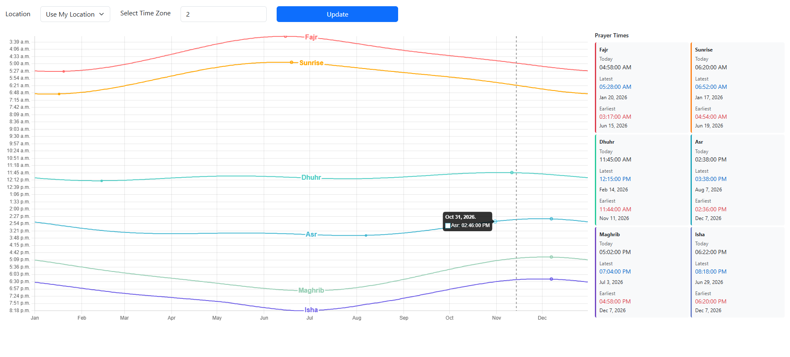

## Purpose

Display prayer times for every day throughout the year for a current or specific city.

## Usage

**Demo:** https://hakim83.github.io/PrayerTimes/

You can specify a location by:
- Selecting your current location (requires browser location permission)
- Typing a specific city name to search
- Adjusting the time zone offset in hours

Click the **Update** button to generate:
- A graph showing all prayer times throughout the year (Fajr, Sunrise, Dhuhr, Asr, Maghrib, and Isha)
- A table displaying today's prayer times, along with the latest and earliest occurrence of each prayer time throughout the year

## Development

Built with TypeScript and the [SolidJS](https://www.solidjs.com/) framework.

**Libraries used:**
- [Adhan](https://github.com/batoulapps/adhan-js) - Calculate prayer times, sunrise, and sunset
- [Chart.js](https://www.chartjs.org/) - Visualization of prayer time trends
- [Solid-select](https://solid-select.com/) - Auto-complete city search component
- [Bootstrap](https://getbootstrap.com/) - UI styling and responsive layout